# Mil e Uma Linhas!

Meu código, seu site. Site principal em [mileumalinhas.com.br](https://mileumalinhas.com.br).

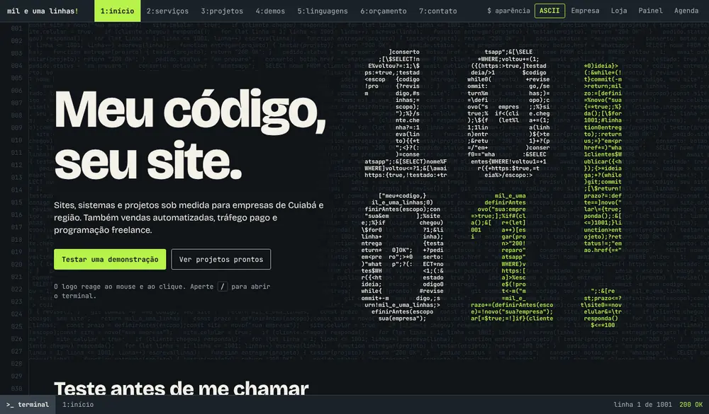

Site estático em HTML, CSS e JavaScript puro, sem dependências. Cookies e requisições a terceiros só existem se a pessoa aceitar a medição de visitas (Google Analytics e Pixel da Meta); sem o aceite, nada de fora é carregado. O navegador guarda a aparência escolhida, a escolha sobre a medição e, nas demonstrações, os dados de teste.

| Pasta ou arquivo | Para que serve |
|---|---|
| `index.html` | Conteúdo de todas as abas |
| `css/site.css` | Aparência |
| Trecho no início do `index.html` | Roda antes de a página ser desenhada: aplica a aparência escolhida e impede que o site seja embutido em outro. Fica dentro da página para não custar um arquivo a mais, e a política de segurança só o aceita pelo código de conferência (`sha256`). Mudou o trecho? Gere o código de novo |
| `js/app.js` | Abas, logo em ASCII, números de linha e terminal |
| `js/temas.js` | As 5 aparências e suas capas interativas |
| `js/orcamento.js` | Montador do pedido e carrinho (fica salvo no aparelho do cliente). **O site não mostra preços:** a lista `PEDIDOS` tem os serviços, planos, adicionais e prazos, e `LINGUAGENS` alimenta a aba que explica cada linguagem. A tabela de preços fica só no servidor de cobranças, que é privado. Mudou a lista `PEDIDOS`? Gere de novo o catálogo do servidor (veja o README dele) |
| `js/pedido.js` | Tela de finalização: confere o carrinho, pede nome, e-mail e WhatsApp, e uma descrição de 500 a 3.000 caracteres do que o cliente quer. Envia ao meu servidor; se ele estiver fora, oferece o e-mail com tudo escrito |
| `js/guia.js` | Aba que explica o que cada linguagem faz. É só informação: quem escolhe a linguagem de cada projeto sou eu |
| `js/medicao.js` | Aviso de consentimento e medição de visitas. Os IDs do Google Analytics e do Pixel da Meta ficam no topo do arquivo; sem eles, o arquivo não faz nada. Os dois só são carregados depois do toque em **Aceitar**, e o botão **Medição**, no rodapé, deixa a pessoa mudar a escolha |
| `js/demos.js` | As demonstrações. Tudo roda no navegador de quem usa |
| `js/linguagens.js` | A mesma regra em 16 linguagens; cada programa foi compilado ou executado de verdade |
| `vitrine/` | Sistemas de demonstração, cada um em sua pasta, com aviso e rodapé comuns em `assinatura.css` |
| `fonts/` | Bricolage Grotesque e JetBrains Mono, servidas daqui (licença OFL) |
| `pagar/` | Página de pagamento por Pix: lê o código do link (`?c=`), busca valor, referência e situação no meu servidor de cobranças (Cloudflare Workers e D1, repositório privado) e gera o QR Code e o código copia e cola no navegador, no padrão BR Code do Banco Central |

Para rodar no computador, sirva a pasta com qualquer servidor local, como `python3 -m http.server`.

---

Desenvolvido por Rodrigo Terroso Junior. O Claude, da Anthropic, foi usado como ferramenta durante o desenvolvimento.

## Como o cliente faz um pedido

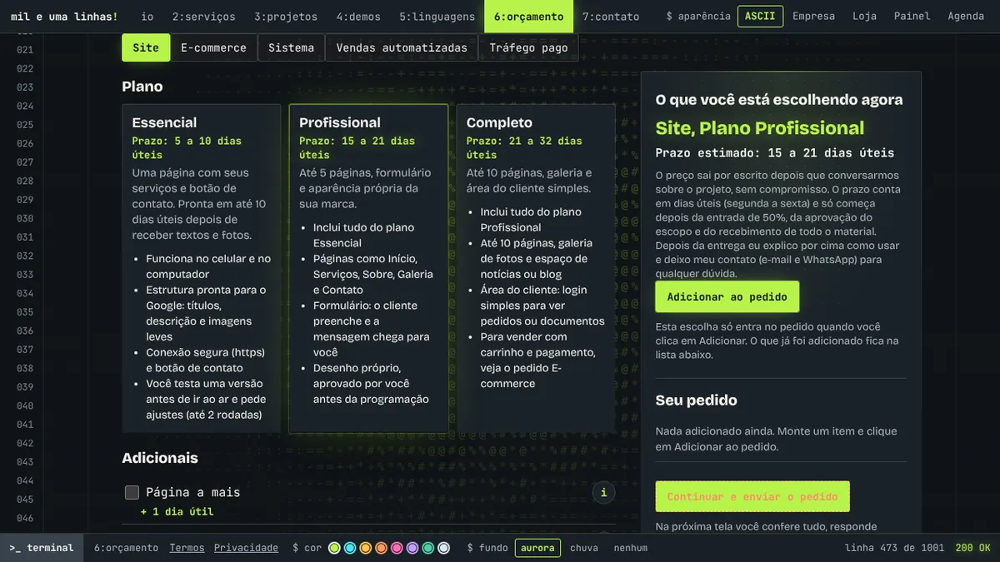

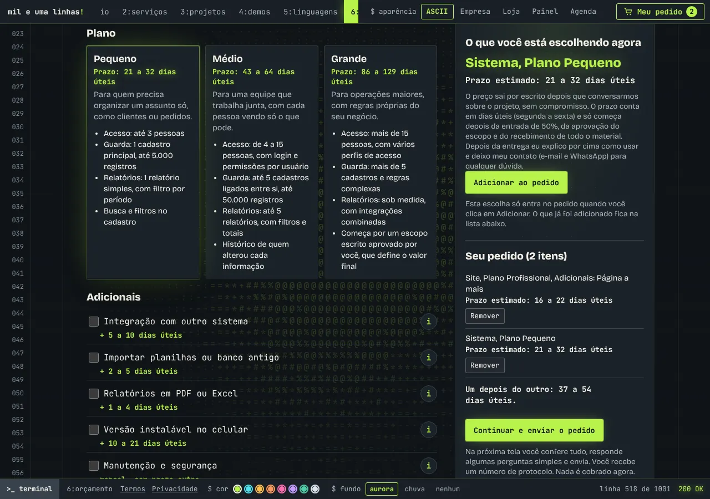

1. Na aba orçamento, o cliente escolhe o tipo, o plano e os adicionais e clica em **Adicionar ao pedido**. Cada item mostra o prazo estimado; o preço não aparece no site e sai depois, no orçamento por escrito. Cabem até 10 itens e o carrinho fica salvo no aparelho (`localStorage`, só as escolhas, nunca dados pessoais).
2. Em **Finalizar pedido** ele confere os itens, informa nome, e-mail e WhatsApp (todos obrigatórios) e escreve, com no mínimo 500 e no máximo 3.000 caracteres, exatamente o que quer. A tela traz perguntas para guiar o texto, e o rascunho fica só na aba aberta.
3. Ao enviar, o navegador manda ao meu servidor apenas as **escolhas**. O servidor confere cada escolha com o catálogo e calcula o preço de tabela, que aparece só no meu painel, para eu montar o orçamento. O e-mail de confirmação do cliente leva os itens e o prazo, sem preço.
4. O cliente recebe um protocolo (`PED2611...`) para citar na conversa. O pedido aparece no meu painel de cobranças com os itens e o texto exatamente como foram enviados.

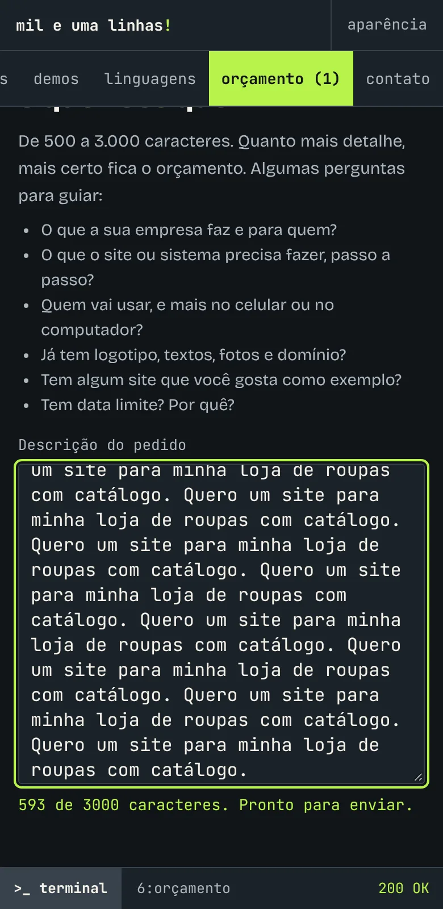

### Adicionais, e-mail e arquivos

Todos os prazos do site são em **dias úteis** (segunda a sexta). Cada adicional mostra o prazo que ele soma, e o botão "i" explica em uma frase o que ele faz. Quem prefere mandar o pedido por e-mail escolhe onde abrir: Gmail, Outlook, Yahoo, o aplicativo do aparelho ou só copiar o texto.

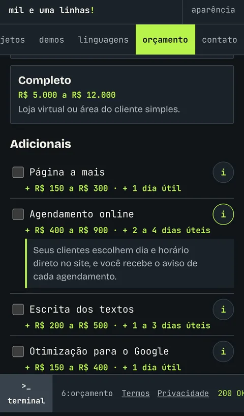 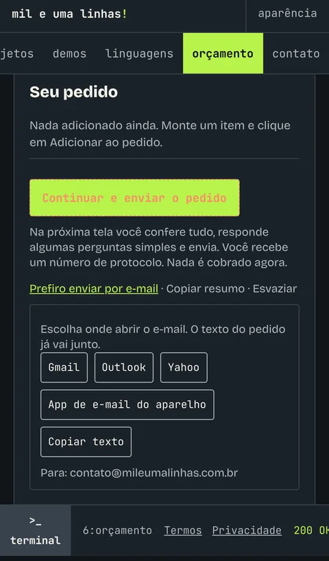 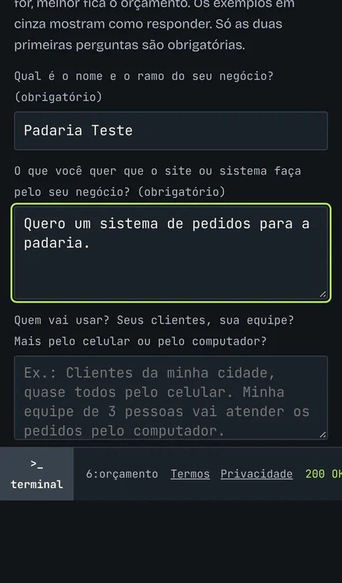

O cliente pode anexar de 1 a 20 arquivos (logotipos, fotos, documentos), com até 25 MB cada e 50 MB no total, arrastando ou escolhendo no aparelho. Os arquivos sobem depois que o pedido é enviado e ficam em armazenamento privado, ligados ao protocolo. Se o envio falhar, o site orienta mandar por e-mail citando o protocolo.

A verificação contra robôs (Turnstile) só é carregada na tela de finalização.

## Vistoria de segurança

Cada alteração passa por conferência de segredos no código, política de segurança de conteúdo (CSP), tratamento de texto digitado e dependências externas. O GitHub Pages não permite definir cabeçalhos HTTP, então a CSP fica em uma etiqueta meta. As demonstrações rodam só no navegador e não enviam dados.

Na página de pagamento, a chave Pix, o nome e a cidade ficam fixos no código. O link leva só um código aleatório de 128 bits; o valor vem do servidor de cobranças, então mexer no link não muda o valor nem o recebedor. A página só conversa com esse servidor (CSP `connect-src`), sem cookies.

No pedido, nome, e-mail, WhatsApp e texto do cliente vão por HTTPS direto ao meu servidor, que os cifra (AES-256-GCM) antes de gravar. A CSP agora permite só o script do Turnstile (`challenges.cloudflare.com`) além do próprio site.

Os arquivos anexados vão em um envio por arquivo, com um token de envio que vale 24 horas e só serve para aquele pedido. O servidor recusa executáveis e scripts, confere tamanho e quantidade, e guarda tudo em um bucket privado (Cloudflare R2), sem endereço público. Só eu, logado no painel, consigo baixar.

## Projetos com imagens

Fiz estas demonstrações para mostrar o que entrego. As empresas e os dados são fictícios. A lista completa, com os links, está na [aba Projetos](https://mileumalinhas.com.br/#projetos).

| | | |
|---|---|---|
| 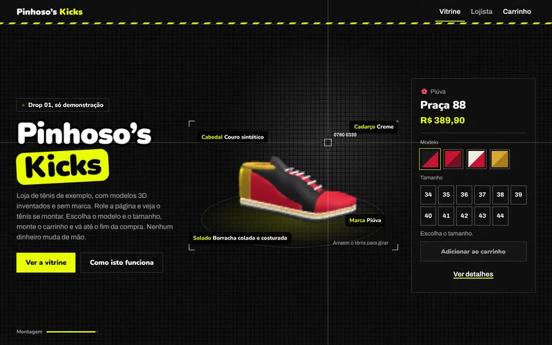 Pinhoso's Kicks | 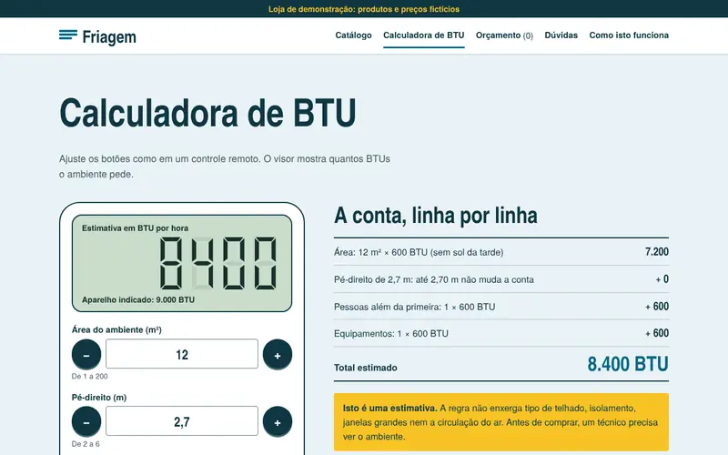 Friagem | 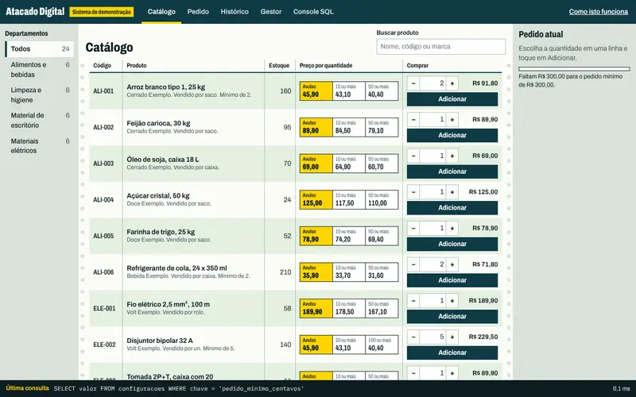 Atacado Digital |
| 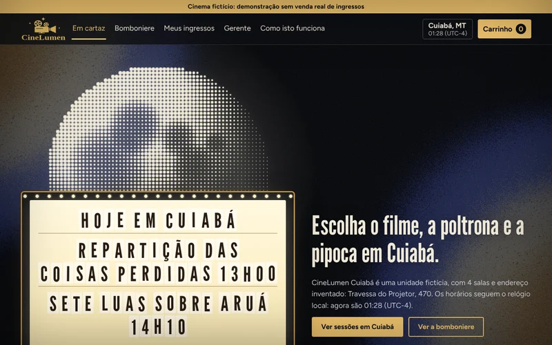 CineLumen |  Clínica Ipê de Agosto | 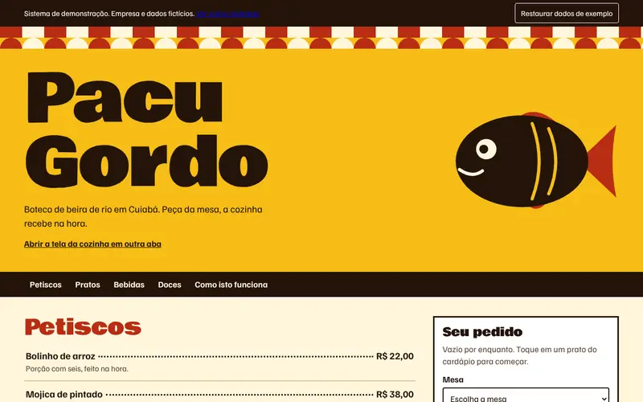 Pacu Gordo |
| 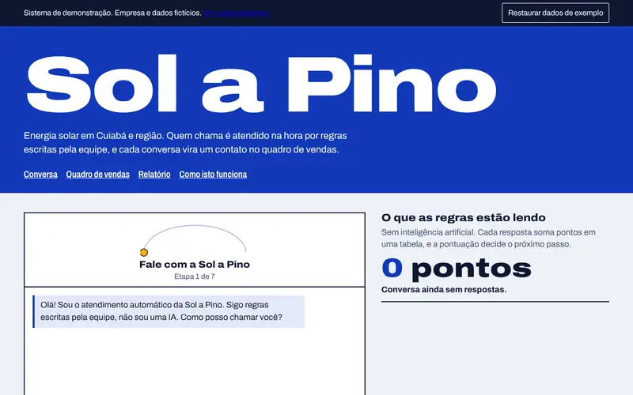 Sol a Pino | 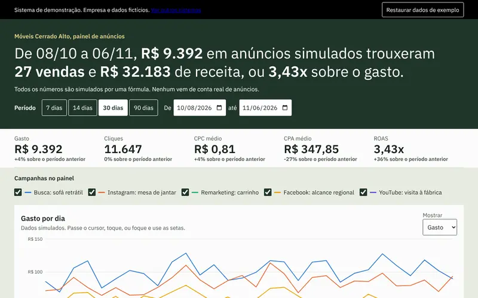 Móveis Cerrado Alto | 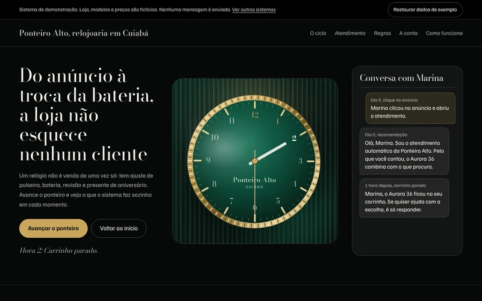 Ponteiro Alto |
| 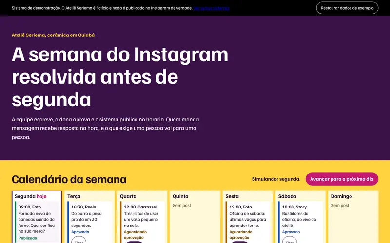 Ateliê Seriema | 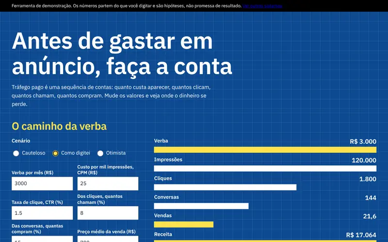 Prancheta de Tráfego | 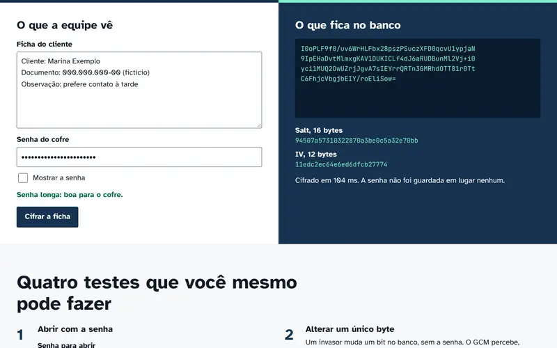 Cofre de Dados |
| 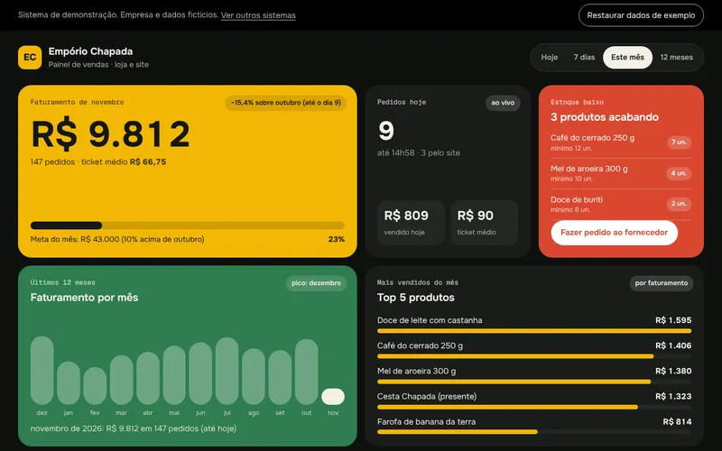 Empório Chapada (painel de vendas) | | |
